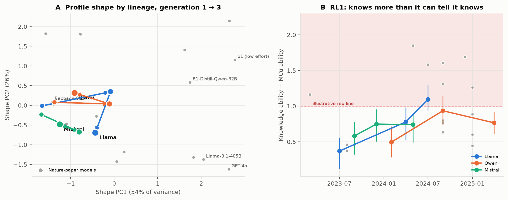
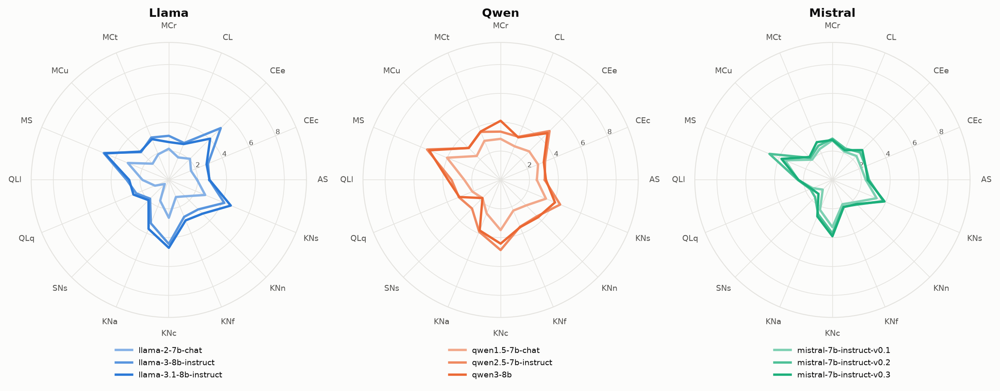
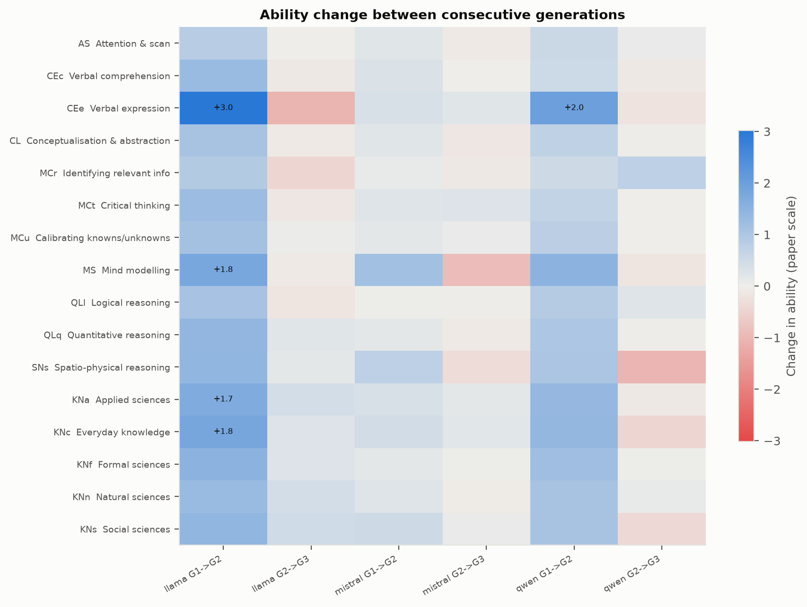
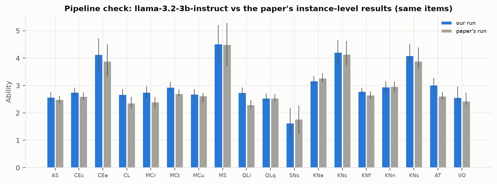

# Finches: ability-profile evolution in open LLM lineages

Do open LLM lineages radiate into niches, like Darwin's finches, or converge on one profile? This repo profiles three
generations of Llama, Qwen and Mistral (7–8B) on the general scales of the ADeLe battery. It then asks how their
ability profiles evolved and what simple profile-based "red lines" actually measure.



## Question

The *diversity* standpoint of Hernández-Orallo et al., "The next Turing tests" (*Science* 393, 2026), argues that AI
progress should be read as an ecosystem of capability profiles rather than a single ladder. Using the method of Zhou
et al., "General scales unlock AI evaluation with explanatory and predictive power" (*Nature* 652, 2026), we ask:

1. **Evolution.** Across generations, which abilities grow? Do lineages' profile *shapes* converge (a monoculture)
   or diverge (niches)?
2. **Red lines.** How does a profile-based red line, such as "knowledge far above metacognition", behave across
   generations and scale, and what does it measure?

## Results

| Finding | Evidence |
| --- | --- |
| The pipeline reproduces the paper | Our Llama-3.2-3B profile vs the paper's on the same 2,250 items: Pearson r = 0.97, Spearman ρ = 0.88, mean offset +0.14; item-level agreement 77.4% |
| The judge is reliable | GPT-4o-mini vs GPT-4o on 200 open-ended items: 91% agreement, Cohen's κ = 0.81 (mini about 5 points more lenient) |
| Growth stalls at fixed size | Mean ability, generation 1→2: Llama +1.43, Qwen +1.02, Mistral +0.34. Generation 2→3: +0.02, −0.08, −0.04 |
| Lineages specialise | Generation 2→3: Llama knowledge +0.37 / metacognition −0.17; Qwen knowledge −0.16 / metacognition +0.26 (MCr +0.75) |
| No monoculture | Mean RMS distance between lineages' profile shapes: 0.17 (generation 1, within noise) → 0.39 → 0.41 |
| The knowledge–MCu gap widens in Llama | RL1: 0.37 → 0.78 → 1.10, slope +0.36 per generation (95% CI 0.23–0.55). Qwen +0.14 (−0.00 to 0.28), Mistral +0.08 (−0.09 to 0.22) |
| …but it mostly tracks knowledge level | Across 25 models, RL1 vs knowledge ρ = 0.88. Per unit of knowledge, MCu rises 0.73, close to CL (0.70) and MCr (0.75), so metacognition is not singled out |
| Open-ended items matter | Adding them lowers abilities by 0.40 on average (CEe by 1.42: MC items cap verbal-expression demand at level 1) |

**Takeaway.** At a fixed size, open lineages stopped improving overall and specialised in different directions.
The obvious knowledge–metacognition red line widens with scale and generation, but it largely re-expresses knowledge
level. It also assumes that levels on different dimensions are commensurate, which is untested.

| | |
| --- | --- |
|  |  |



## Method

- **Items.** 2,250 items from ADeLe v1.0: 1,500 multiple-choice and 750 open-ended. Unguessability ≥ 75, prompts ≤ 10,000
  characters. Drawn with stratified coverage of every dimension × demand-level cell.
- **Models.**

  | Lineage | Generation 1 | Generation 2 | Generation 3 |
  | --- | --- | --- | --- |
  | Llama | Llama-2-7B-chat | Llama-3-8B-Instruct | Llama-3.1-8B-Instruct |
  | Qwen | Qwen1.5-7B-Chat | Qwen2.5-7B-Instruct | Qwen3-8B (thinking off) |
  | Mistral | Mistral-7B-Instruct v0.1 | v0.2 | v0.3 |

  Llama-3.2-3B-Instruct is also run as a validation model, since it appears in the *Nature* paper. The paper's 15 models
  are included as reference points through CFI's released per-item results.
- **Generation.** Kaggle 2× T4 with vLLM; fp16, greedy decoding, 768 new tokens, the battery prompt as one user turn.
- **Scoring.**
  - Multiple-choice: option-letter match, as in the CFI toolkit.
  - Open-ended: GPT-4o-mini judge against the reference answer. All 7,500 calls cost $1.03.
  - Judge check: 200 items regraded by GPT-4o.
- **Ability profiles.** The paper's procedure, ported from CFI's MIT-licensed toolkit:
  1. dominant slice per dimension;
  2. re-weight demand levels;
  3. add a failure anchor at level 20;
  4. fit a weighted logistic regression of success on demand level;
  5. ability = area under the fitted curve on [0, 100].

  95% CIs come from 200 item bootstraps.
- **Analyses.**
  - Level (mean of the 16 core dimensions) vs shape (profile minus level).
  - Growth between generations.
  - Shape distance between lineages per generation.
  - Red lines (illustrative threshold 1.0):
    - RL1 = mean knowledge − MCu
    - RL2 = mean(QLl, QLq) − mean(MCr, MCt)
  - An instance-level check and an MC-only sensitivity fit.

## Reproduce

| Step | Where | Command |
| --- | --- | --- |
| Setup | Codespaces | `bash scripts/setup_cpu.sh`, then `bash tests/run_synthetic.sh` (whole CPU pipeline on fake data) |
| Battery | Codespaces | accept the dataset terms on Hugging Face; put `HF_TOKEN=...` in `.env`; `set -a; source .env; set +a`; `python src/data.py fetch` |
| Item subset | Codespaces | `python src/data.py subset`, then commit `data/subset_ids.csv` (IDs only) |
| Reference results | Codespaces | `sudo apt-get update && sudo apt-get install -y git-lfs && git lfs install && bash scripts/fetch_reference.sh` |
| Generation | Kaggle, GPU T4 ×2, Internet on | `notebooks/kaggle_generate.ipynb` with secrets `HF_TOKEN`, `KAGGLE_USERNAME`, `KAGGLE_KEY`; one run per `BATCH` (`llama,validation`, `qwen`, `mistral`) via **Save & Run All**; responses are uploaded to a private Kaggle dataset |
| Responses | Codespaces | download each dataset and run `unzip -o responses.zip` at the repo root |
| Analysis | Codespaces | add `OPENAI_API_KEY` to `.env`, then `bash scripts/run_analysis.sh` (scoring, judging, agreement check, profiles, evolution, red lines, figures) |

Llama models need Meta's licence accepted on each model page (Llama 2, 3, 3.1 and 3.2 are separate requests). Qwen and
Mistral are ungated. Settings live in `configs/run.yaml`, models in `configs/models.yaml`.

## Repository layout

```
configs/      run settings, model registry
src/          data.py, generate.py, score_mc.py, judge.py, judge_agreement.py, collect.py,
              profiles.py, evolution.py, redlines.py, plots.py, common.py
notebooks/    kaggle_generate.ipynb
scripts/      setup, reference download, full analysis
tests/        synthetic end-to-end test
data/         subset_ids.csv, subset_coverage.csv (item IDs only)
scores/       per-model correctness (item ID + 0/1)
results/      profiles with CIs, growth, convergence, red lines, validation, judge agreement
figures/      fig1–fig4
```

## Data handling

The ADeLe battery is gated and asks users not to publish its items, to avoid leakage into training data. This repo
contains only item IDs, correctness, profiles and figures. The battery file, model responses (which can quote
questions), judge caches and the paper's per-item files are gitignored. The data was not republished or used for
training.

## Limitations

- ADeLe v1.0 has no items above level 5. Abilities above 5 (large reference models) are extrapolated, and they drive
  the scale trend in RL1.
- Three lineages × three generations at one size: trends are descriptive; read the CIs.
- GPT-4o-mini is slightly more lenient than GPT-4o. The shift is uniform across models, but there was no human
  adjudication.
- Decoding, prompting and MC grading differ from the paper (the paper used LLM graders for every item). Lineage vs
  reference comparisons therefore carry an offset of about 0.14.
- SNs and MS rest on 150 and 132 items; their changes are within noise.
- Bootstrap shape distances are biased upward, so convergence is read ordinally.
- Capabilities only, text-only and single-turn: no propensities, tools or agents.

## Next steps

Forecast profiles before release, extend the scales above level 5, test whether dimensions are commensurate (e.g. via
human baselines), redefine red lines as residuals ("MCu below what knowledge predicts") and add propensity scales.

## Credits

- Zhou, L., Pacchiardi, L., Martínez-Plumed, F., … Cheke, L., Xie, X. & Hernández-Orallo, J. (2026). General scales
  unlock AI evaluation with explanatory and predictive power. *Nature* 652, 58–67.
  [doi:10.1038/s41586-026-10303-2](https://doi.org/10.1038/s41586-026-10303-2)
- Hernández-Orallo, J., Collins, K. M., … Cave, S. (2026). The next Turing tests: Reimagining conceptions and measures
  of AI. *Science* 393, 566–568. [doi:10.1126/science.aee3176](https://www.science.org/doi/10.1126/science.aee3176)
- ADeLe battery, DeLeAn rubrics and toolkit: Kinds of Intelligence team, Leverhulme Centre for the Future of
  Intelligence. [Project page](https://kinds-of-intelligence-cfi.github.io/ADELE/) ·
  [toolkit (MIT)](https://github.com/Kinds-of-Intelligence-CFI/ADeLe-AIEvaluation). Adapted code is credited in `NOTICE`.

Author: Puneet Mishra (MSc Data Science & AI, IIT Madras / University of Birmingham)